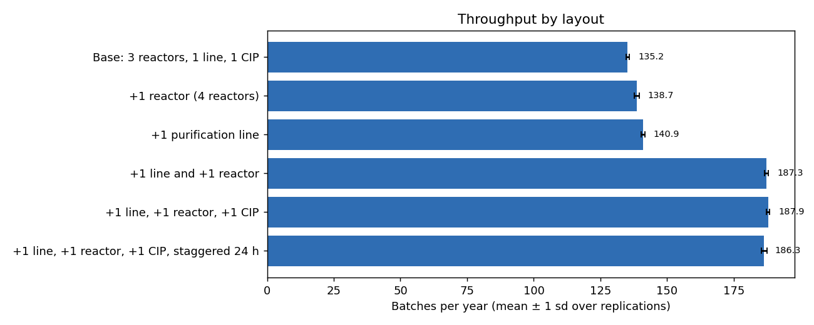
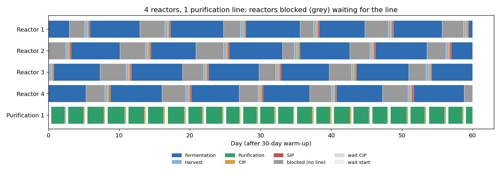
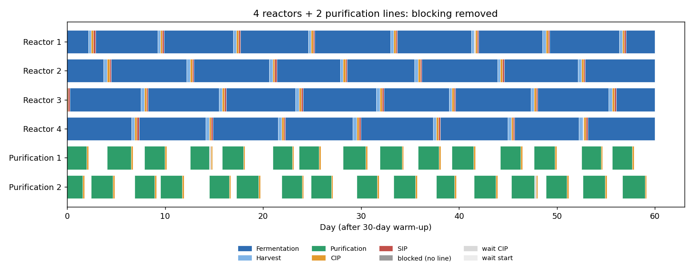
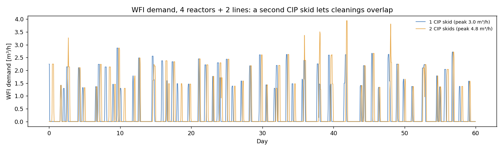

# API Facility Capacity & Utility Simulation

A discrete-event simulation (Python, SimPy) of a small biologic API production area, built to answer the kind of questions asked **early in facility design**:

- How many batches per year can this equipment layout deliver?
- Which equipment is the bottleneck?
- What peak **WFI** (water for injection) and **clean steam** demand must the utility systems be sized for?
- What does it gain to add a bioreactor, a purification line or a CIP skid, or to stagger batch starts?

This is the same type of model that tools such as INOSIM are used for, written from scratch to show the method.

## The process

```
Bioreactor:        Fermentation ──► Harvest ──► CIP ──► SIP ──► next batch
                                      │
                                      ▼  (needs a free line, otherwise the reactor is BLOCKED)
Purification line:                Purification ──► CIP
CIP skids:         shared by all reactors and lines; every cleaning draws WFI
SIP:               steam-in-place of the reactor; draws clean steam
```

- Durations follow triangular distributions (e.g. fermentation 150 / 168 / 190 h), so every run is different.
- Each scenario runs **20 replications of one year**, after a 30-day warm-up that is not counted.
- Utility demand is calculated hour by hour, so peaks from overlapping cleanings are visible.

> All durations and utility figures are **illustrative**, not data from a real facility. The value of the project is the method: build the model, compare alternatives, turn the results into a recommendation.

## Results (20 replications per scenario)

| Scenario | Batches / year | Reactor utilisation | Reactors blocked | Line utilisation | CIP utilisation | Bottleneck | Peak WFI (m³/h) | Peak steam (kg/h) |
|---|---|---|---|---|---|---|---|---|
| Base: 3 reactors, 1 line, 1 CIP | 135.2 ± 0.7 | 95 % | 4 % | 85 % | 14 % | Bioreactors | 2.9 | 250 |
| +1 reactor (4 reactors) | 138.6 ± 0.9 | 73 % | **26 %** | 87 % | 14 % | **Purification** | 2.9 | 250 |
| +1 purification line | 140.8 ± 0.9 | 99 % | 0 % | 44 % | 14 % | Bioreactors | 2.9 | 255 |
| **+1 line and +1 reactor** | **186.9 ± 0.8** | 99 % | 0 % | 59 % | 19 % | Bioreactors | 2.9 | 255 |
| +1 line, +1 reactor, +1 CIP | 187.4 ± 0.8 | 99 % | 0 % | 59 % | 10 % | Bioreactors | 5.1 | 500 |
| +1 line, +1 reactor, +1 CIP, staggered 24 h | 186.2 ± 0.9 | 98 % | 0 % | 59 % | 10 % | Bioreactors | 4.7 | 395 |



## What the results say

1. **Adding a reactor alone does almost nothing (+2.5 %).** The single purification line becomes the bottleneck, and the four reactors spend **26 % of their time blocked**, full of product and waiting for the line (grey bars below).
2. **Adding a line alone also does little (+4 %).** The reactors were already the limit in the base layout, so the new line sits half idle (44 %).
3. **Adding both together gives +38 % (135 → 187 batches/year).** The two constraints are linked, so they have to be removed together. This is the kind of result that is hard to see on a spreadsheet and easy to see in a dynamic simulation.
4. **A second CIP skid adds no capacity** (+0.5 batches, within the noise). One skid is only 19 % utilised. But it lets cleanings and sterilisations overlap, so **peak WFI rises by ~75 % (2.9 → 5.1 m³/h) and peak steam doubles (250 → 500 kg/h)**. The utility systems would have to be sized larger for no production gain.
5. **Staggering batch starts by 24 h** reduces those peaks somewhat (steam 500 → 395 kg/h) at a cost of about one batch per year.

**Recommendation for this example:** expand with one bioreactor **and** one purification line, and keep a single CIP skid. This gives +38 % throughput while keeping the WFI and steam systems at their current size.





## How to run

```
pip install -r requirements.txt
python facility_sim.py              # 10 replications per scenario
python facility_sim.py --reps 20    # the settings used above
```

Results are written to `results/` (`scenario_results.csv` and the figures). A full run takes a few seconds.

To try your own layout, add a line to `SCENARIOS` in `facility_sim.py`, for example:

```python
Scenario("5 reactors, 2 lines", reactors=5, purification_lines=2),
```

## Limitations and next steps

- Illustrative parameters, one product, no seed train, no media/buffer preparation and no operator constraints.
- No equipment failures or maintenance windows.
- Next steps: add buffer-preparation tanks and their WFI demand, operator shifts, and a cost per scenario to support a business case.

*Author: Mohamed Yosif Abdo – M.Sc. Electrical Engineering (Automation & Robot Technology), DTU*
